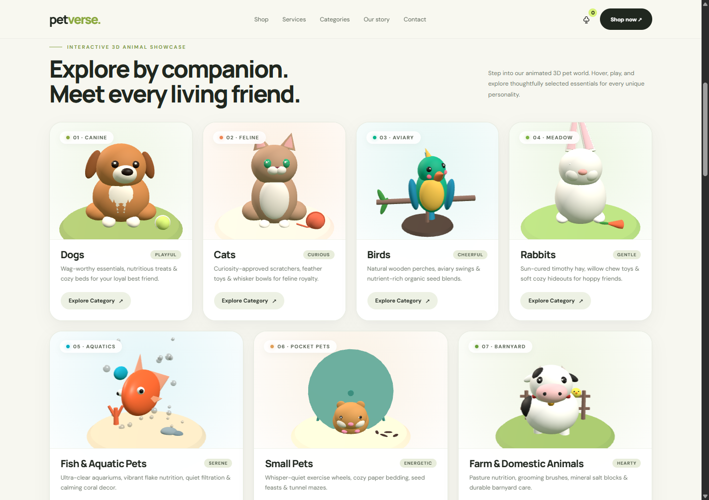

# PetVerse 🐾 – Interactive Animated 3D Pet Showcase & Store

A modern, interactive pet essentials web experience featuring **seven living, animated 3D companion characters** powered by **Three.js**.



---

## ✨ Features

### 1. Animated 3D Companion Showcase (7 Categories)
Each category features a dedicated procedurally rigged 3D animal with natural idle behaviors and playful mouse interactions:

1. **🐕 Dogs (Canine)**: Seated puppy with tail wagging, smooth head tilts, eye blinking, playful paw tap, and excited bouncing with rapid tail wagging on hover.
2. **🐈 Cats (Feline)**: Calico cat with curling multi-segment tail, ear twitches, eye blinking, back-arch stretch & yawn cycle, and playful paw swats on hover.
3. **🦜 Birds (Aviary)**: Vibrant tropical parrot perched on a branch, natural wing flapping, hop-and-flutter sequence, curious head cocking, and enthusiastic wing flutter on hover.
4. **🐇 Rabbits (Meadow)**: Fluffy bunny with swiveling long ears, continuous rapid nose twitching, gentle hop cycle, paw face-cleaning sequence, and joyful twist jump (*binky*) on hover.
5. **🐠 Fish & Aquatic Pets (Aquatics)**: Radiant clownfish and companion fish with rhythmic fin flutter, 3D figure-8 swimming paths with banking, rising translucent bubbles particle system, and pointer attraction on hover.
6. **🐹 Small Pets (Pocket Pets)**: Chubby Syrian hamster with spinning exercise wheel with spokes & stand, synchronized running strides, sniffing nose twitch, standing on hind legs, and curious tiptoe sniff on hover.
7. **🐄 Farm & Domestic Animals (Barnyard)**: Spotted Holstein calf with bell collar, blinking, tail swish, and stepping hooves, plus a baby yellow chick fluttering on a rustic fence rail; joyful bounce on hover.

---

### 2. Interactive 3D Card Dynamics & Navigation
- **Dynamic 3D Perspective Tilt**: Moving your cursor over any card tilts the card physically in 3D space (`perspective`, `rotateX`, `rotateY`, `scale3d`).
- **Environmental Lighting**: Matching radiant glow effects tailored for each pet habitat (Garden, Cozy indoor, Tropical aviary, Green meadow, Oceanic reef, Cedar habitat, Morning pasture).
- **Smooth Shop Filtering**: Clicking any category card (or pressing `Enter`/`Space`) instantly filters the product grid to that companion category, triggers a toast notification, and smoothly scrolls to `#shop`.

---

### 3. Hero 3D Companion
- Hero section features a 3D animated puppy with interactive cursor-following head movements and ambient lighting.

---

### 4. Complete E-Commerce Demo Features
- **Dynamic Product Filtering**: Filter by Dogs, Cats, Birds, Rabbits, Fish, Small Pets, Farm Animals, Food, and Toys.
- **Cart Slide-out Drawer**: Add/remove items with real-time subtotal calculation in INR (₹).
- **Service Booking Modal**: Book gentle grooming, veterinary wellness, or nutrition consultation sessions.
- **Responsive Design**: Fluid layout adapting across Desktop (12-column balanced grid), Tablet (2-column), and Mobile (single-column).
- **High Performance & Accessibility**: Canvases outside the viewport are automatically paused via `IntersectionObserver` (0% GPU idle load), with device pixel ratio scaling and `prefers-reduced-motion` compliance.

---

## 🚀 Getting Started

No build step or dependencies required! Everything runs standalone in modern browsers.

### Option 1: Direct File Opening
Double-click `index.html` or `petverse_3d_mockup.html` to open it in your browser.

### Option 2: Local HTTP Server
```bash
# Using Node.js
npx serve .

# Or using Python 3
python -m http.server 8000
```
Open `http://localhost:8000` or the URL displayed in your terminal.

---

## 🛠️ Built With
- **Three.js (r160)** for WebGL 3D procedural modeling, lighting, rigging, and animation loops.
- **Vanilla JavaScript (ES Modules)** for zero-dependency modular architecture.
- **CSS3 3D Transforms & Grid** for modern, responsive card layouts and physics tilt.
- **IntersectionObserver & ResizeObserver** for high-efficiency rendering.

---

## 📄 License
MIT License. Feel free to use and adapt for your own creative projects!

